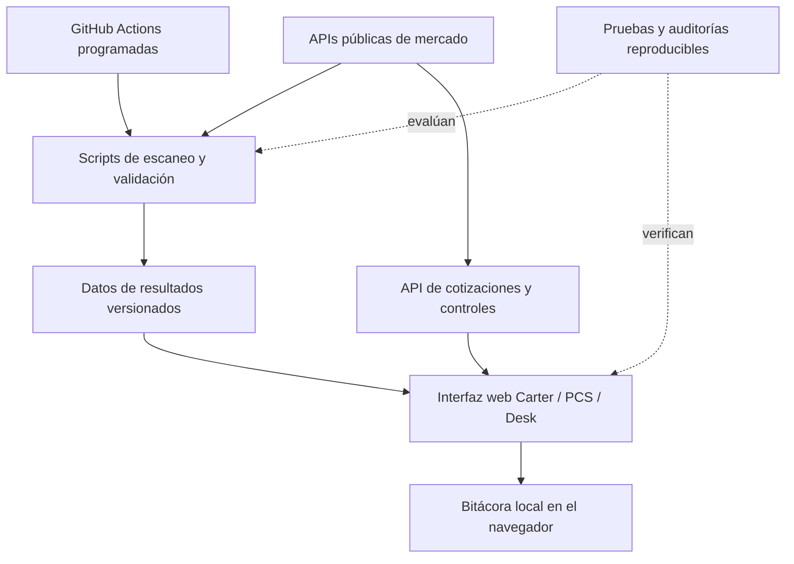

# Arquitectura y validación de producto — Carter

**Proyecto de ingeniería e investigación personal.** Documento orientado a describir el sistema desde la perspectiva de diseño, automatización, trazabilidad y gestión de riesgo.

## Alcance

La aplicación integra motores de análisis experimental, datos públicos, publicación programada de resultados, una interfaz web y una bitácora local de simulación. La documentación distingue el motor de señales, los tickets preparados y las operaciones simuladas.

## Diagrama de alto nivel

## Aspectos técnicos relevantes

1. **Flujos programados:** workflows separados para escaneo, validación y tareas de diagnóstico.
2. **Control de carreras:** la documentación indica un pipeline de publicación unificado para evitar escrituras simultáneas de resultados.
3. **Revalidación:** los datos de un escaneo previo no se consideran una cotización ejecutable actual.
4. **Trazabilidad:** separación entre propuestas, simulaciones y fills declarados manualmente.
5. **Evaluación de hipótesis:** resultados, límites y dictámenes desfavorables se conservan y documentan.
6. **Seguridad funcional:** se declara que no se transmiten órdenes reales en el flujo descrito.

## Evidencia y referencias

- [README técnico y advertencias](../README.md)
- [Pruebas automatizadas](../tests/)
- [Investigación y protocolos](../research/)
- [Workflows](../.github/workflows/)

## Limitaciones

Las reglas no constituyen un sistema aprobado para operación financiera real. No se demostró rentabilidad futura, persistencia privada multi-dispositivo ni auditoría de seguridad externa de todos los componentes. Los resultados históricos deben leerse con sus costos, muestras y limitaciones.

**Enfoque profesional:** ingeniería de producto, automatización, control de riesgo, criterio de aceptación y evidencia reproducible.
